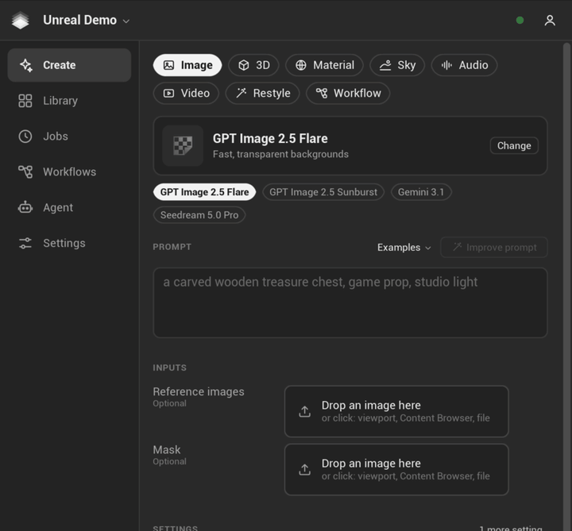
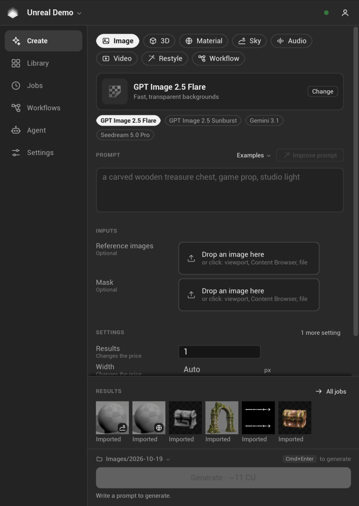
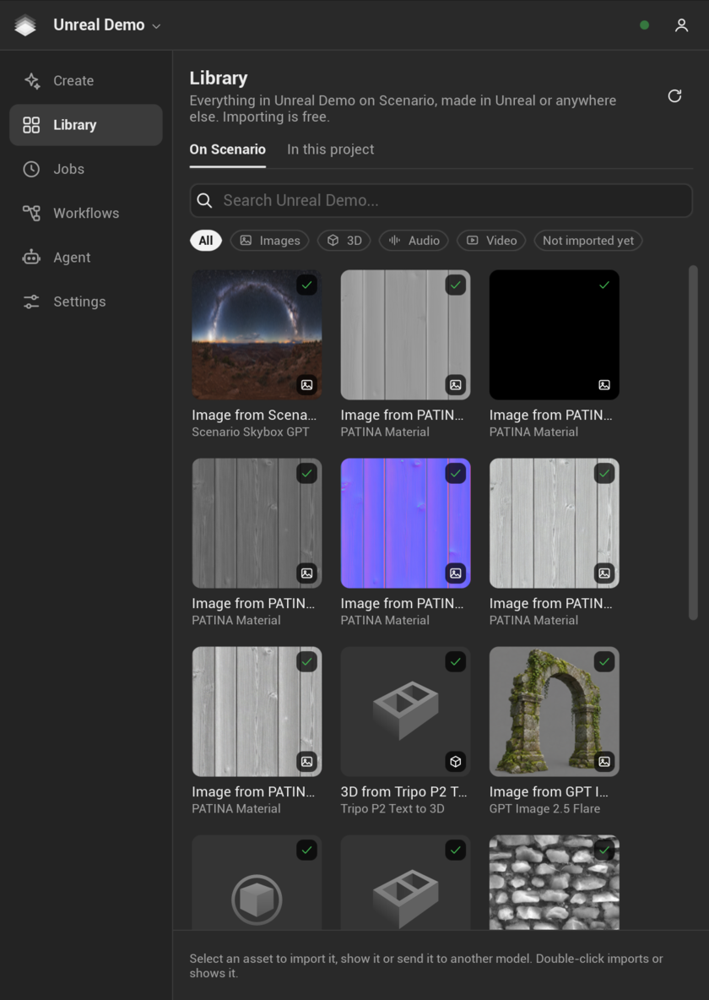
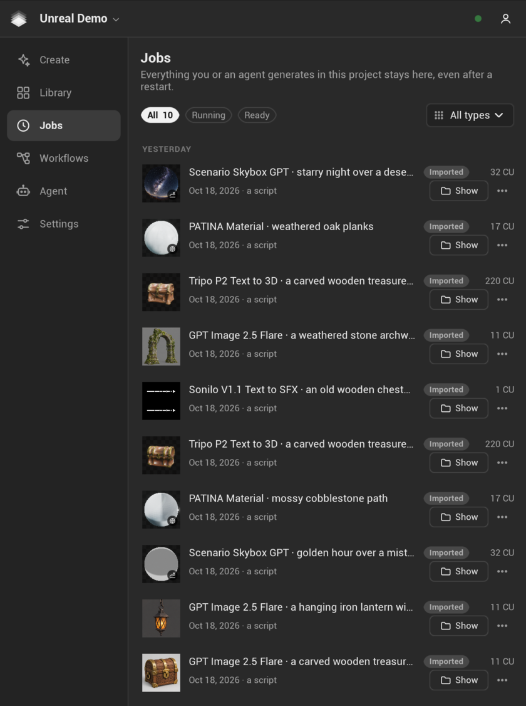
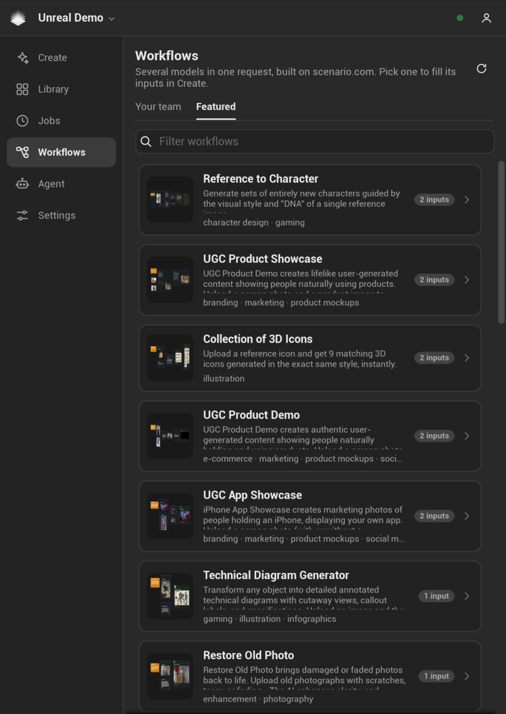
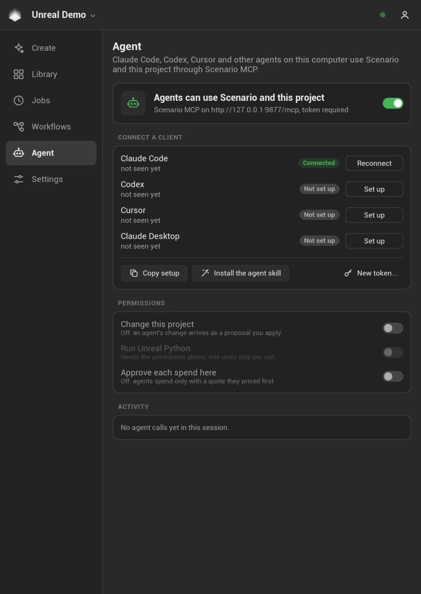
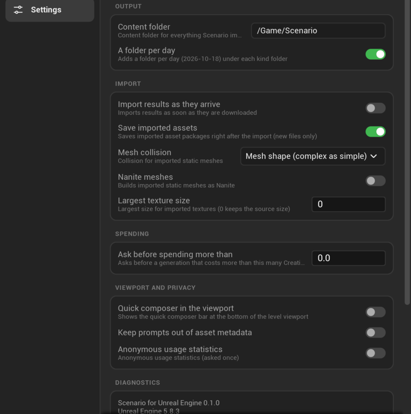
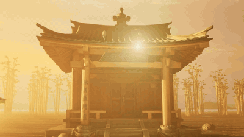

<p align="center">
  <a href="https://www.scenario.com/"></a>
</p>
<h1 align="center">Scenario for Unreal Engine</h1>
<p align="center">
  <a href="https://github.com/scenario-labs/unreal-plugin/releases"></a>
  <a href="https://github.com/scenario-labs/unreal-plugin/actions/workflows/ci.yml"></a>
  <a href="LICENSE"></a>
  
  <a href="https://docs.scenario.com"></a>
  <a href="https://help.scenario.com"></a>
  <a href="https://scorecard.dev/viewer/?uri=github.com/scenario-labs/unreal-plugin"></a>
</p>


Every Scenario model inside the Unreal Editor: images, video, 3D, PBR materials, audio and skies. Each request is priced before you send it, and each result lands as a native Unreal asset, placed in your level in one undo step. For games, virtual production, film, architecture and previs.

People use the Studio tab and a quick composer in the viewport. Agents (Claude Code, Codex, Cursor, Claude Desktop) use the same features through the plugin's local Scenario MCP server.

- **Every model and workflow** in your Scenario account, including your team's trained models, with lanes and recommended picks for Unreal.
- **Priced first.** The Generate button shows the exact Creative Unit cost of your settings; a paid request is sent once and survives editor restarts.
- **Native results.** Meshes through Interchange with PBR materials, skeletons and morph targets; textures with the right settings per map; material instances; Sound Waves; Media Plates; sky spheres and HDRI backdrops.
- **Provenance.** Every imported asset keeps its model, prompt, price and job id, stripped from cooked builds.
- **Agents.** A local Scenario MCP server with one-click setup, price quotes, permissions and an activity log.

## The Studio

The **Scenario** button in the level editor toolbar opens the Studio, a tab you can dock anywhere. Six pages sit on its left rail.



| | | |
| --- | --- | --- |
| [](docs/images/studio-create.png) | [](docs/images/studio-library.png) | [](docs/images/studio-jobs.png) |
| **Create.** Pick a lane and a model, write a prompt, add references. The Generate button shows the exact price. | **Library.** Everything in your Scenario project, made in Unreal or anywhere else. Importing is free. | **Jobs.** Every request from you or an agent, by day. Jobs survive editor restarts. |
| [](docs/images/studio-workflows.png) | [](docs/images/studio-agent.png) | [](docs/images/studio-settings.png) |
| **Workflows.** Several models in one request, built on scenario.com, filled in Create. | **Agent.** Connect Claude Code, Codex, Cursor or Claude Desktop in one click, set permissions, read the activity log. | **Settings.** Where results go, how they import, when to ask before spending. |

## Agents: a prompt to a world, a game or a film

Agents reach the plugin through its local Scenario MCP server. Besides generating, pricing and importing, they get a small kit that turns Scenario results into something you can walk or watch:

- `build_world` and `dress_world`: a walkable level with sun, sky, fog and ground, dressed with Scenario 3D results.
- `make_game`: pickups, a goal, a timer and music on the open level.
- `make_film` and `render_film`: a Level Sequence with cine cameras around the landmark, rendered with Movie Render Queue.
- `play_level` and `kit_status`: play the result in the editor and check what was built.

The three clips below come from one level, rendered in Unreal 5.8 with Movie Render Queue at 720p. An agent built the level from one prompt: Scenario made the shrine, torii, lantern, bamboo and rock models, the ground and path materials, the sky and the ambience; `build_world` and `dress_world` laid them out, and a few Python steps placed the torii and lit the lanterns. The game and the film were then made with the kit tools through the local Scenario MCP, with music from Scenario. Click a preview for the video.

| | | |
| --- | --- | --- |
| [](docs/media/world-flythrough.mp4) | [](docs/media/game-lantern-hunt.mp4) | [](docs/media/film-misty-shrine.mp4) |
| **World.** A walk up the path and an orbit around the shrine (`make_film`, `render_film`). | **Game.** `make_game` turned the level into Lantern Hunt: eight lantern pickups, a goal at the shrine, a timer and Scenario music. Play it with `play_level`. | **Film.** Six shots with cuts, fades and a Scenario score (`make_film`, `render_film`). |

The [Scenario MCP guide](docs/MCP_GUIDE.md) lists every tool and the permissions they need.

## Requirements

- Unreal Engine 5.6, 5.7 or 5.8 (Editor). macOS is the tested platform in version 0.2; Windows and Linux are compiled but not tested yet.
- A Scenario account: [app.scenario.com](https://app.scenario.com).

## Install

Unzip the release into your project so the folder reads `<Project>/Plugins/Scenario/Scenario.uplugin`, open the project, and click the **Scenario** button in the level editor toolbar. Release zips are not signed yet: on macOS, run `xattr -dr com.apple.quarantine "<Project>/Plugins/Scenario"` once if the editor cannot load the plugin.

From source: clone this repository and copy `Plugins/Scenario/` into your project's `Plugins/` folder; Unreal builds it when the project opens (needs a C++ toolchain).

## Documentation

- [Quick start](docs/QUICK_START.md): a first asset in your level in two minutes.
- [User guide](docs/USER_GUIDE.md): sign-in, lanes, jobs and recovery, imports, settings, scripting.
- [Scenario MCP guide](docs/MCP_GUIDE.md): connect an agent, permissions, tools.
- [Troubleshooting](docs/TROUBLESHOOTING.md)
- [Privacy](docs/PRIVACY.md): what is sent, stored and kept local.
- [Architecture](docs/ARCHITECTURE.md): for contributors.

## Development

The repository root is a host project (`ScenarioHost.uproject`) for building and testing the plugin. With Unreal installed (`UE_ROOT` points to it):

```sh
tools/build.sh --host   # package the plugin and build the host editor target
tools/test.sh           # automation tests, headless
python3 tools/lint.py   # repository checks that need no engine
```

Rules for contributors and coding agents are in [AGENTS.md](AGENTS.md) and [CONTRIBUTING.md](CONTRIBUTING.md). Report security issues as described in [SECURITY.md](SECURITY.md); for help, see [SUPPORT.md](SUPPORT.md).

## License

[MIT](LICENSE). Scenario is a trademark of Scenario Inc. Unreal and Unreal Engine are trademarks of Epic Games, Inc.
